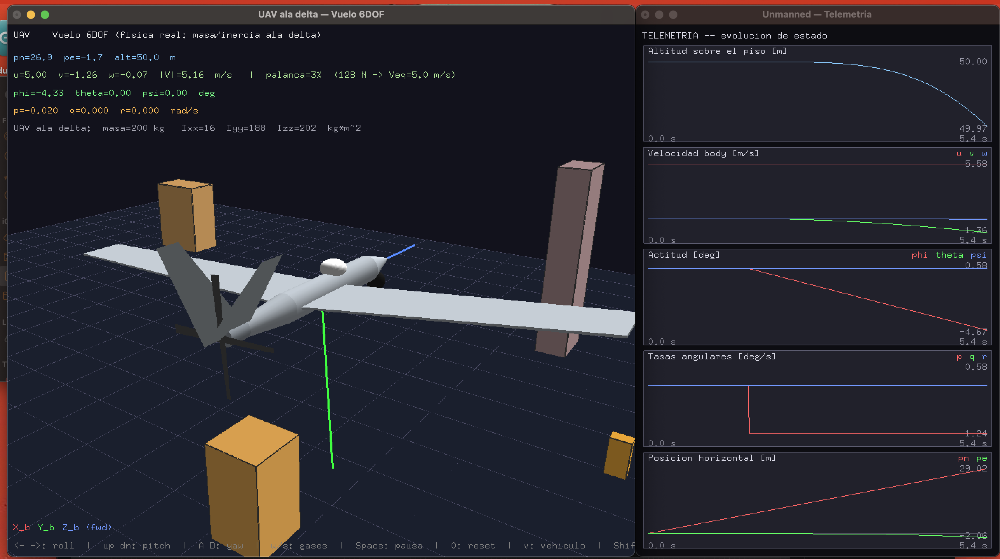
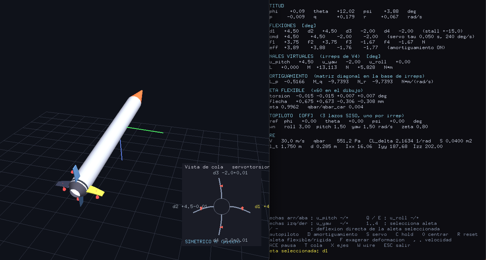
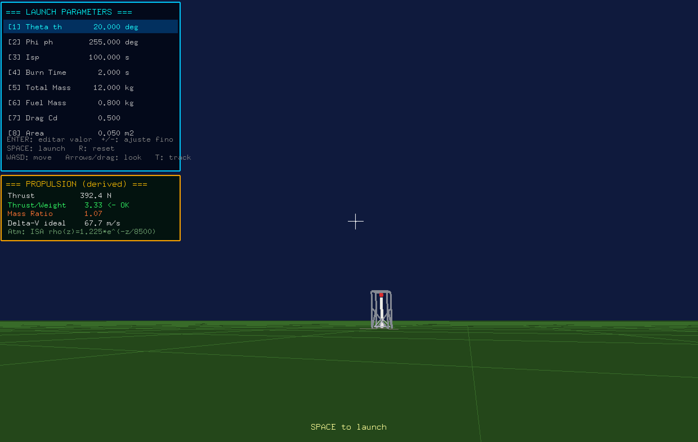
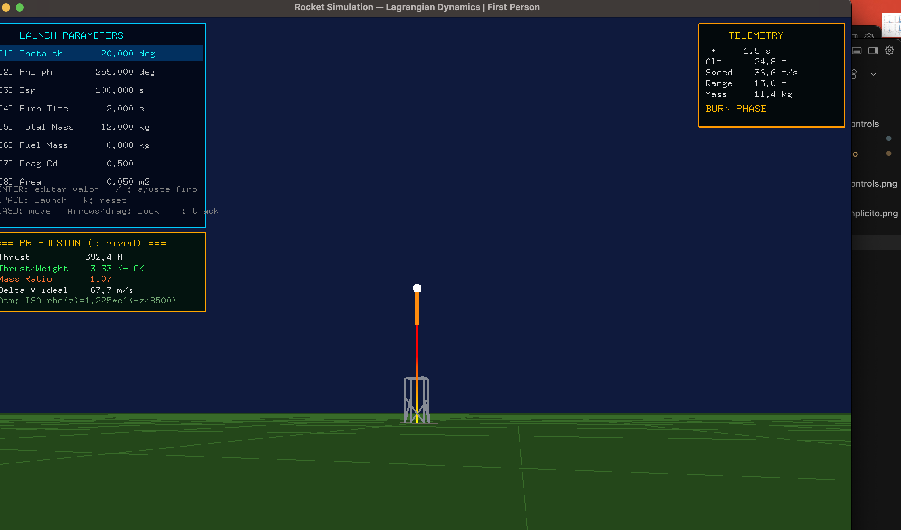

# PERSONAL PROJECTS IN MY FREE TIME ... 

Repository with five projects: three physics simulations in C++ (two based
on Beard & McLain's equations, *Small Unmanned Aircraft: Theory and
Practice*, and one on Lagrangian mechanics), one radar design/analysis
project in MATLAB, and one course-material project on complex systems
architecture. The first four are meant to be compiled/run as-is once you
clone this repo.

## Projects

| Folder | What it does | README |
|---|---|---|
| [`unmanned/`](unmanned/README.md) | **Full 6DOF** flight engine (position + attitude) for three vehicles — delta-wing UAV, quadcopter, and tilt-rotor convertiplane — with an interactive 3D visualization, live telemetry, an obstacle field, and a console demo. Also includes, as a separate module, a rocket-launch simulation built on Lagrangian mechanics (`unmanned/launch_rockets/`). | [`unmanned/README.md`](unmanned/README.md) |
| [`aerodynamical_controls/`](aerodynamical_controls/README.md) | **Attitude** dynamics (no position or translation) of a rocket with four cruciform tail fins: symmetry-based decoupling, aerodynamic damping, flexible-fin aeroelasticity, actuator dynamics, and a PID autopilot. Validated with 79 test cases and byte-for-byte parity between a C++ implementation and a Python one. | [`aerodynamical_controls/README.md`](aerodynamical_controls/README.md) |
| [`rockets_sim/`](rockets_sim/README.md) | **First-person** rocket launch with Lagrangian mechanics (same engine as `unmanned/launch_rockets/`): a live-editable mission-parameter panel (angle, Isp, masses, drag), a derived-propulsion panel (T/W, mass ratio, Δv), and real-time flight telemetry. | [`rockets_sim/README.md`](rockets_sim/README.md) |
| [`MATLAB_RADAR/`](MATLAB_RADAR/README.md) | Design and analysis of a **PMCW radar** for small-UAV detection (detectability budget, Pd vs. range, range-Doppler coverage, two atmospheric-refraction models), plus the preliminary physical design of the 64Tx/64Rx, 79 GHz antenna array that would feed it. | [`MATLAB_RADAR/README.md`](MATLAB_RADAR/README.md) |
| [`MIT_Architecture_of_Complex_Systems/`](MIT_Architecture_of_Complex_Systems/README.md) | Course material (MIT xPro, *Architecture and Systems Engineering*): weekly deliverables on decomposing complex systems, evaluating architectural decisions, and Model-Based Systems Engineering (MBSE). Not code — these are the course assignment PDFs. | [`MIT_Architecture_of_Complex_Systems/README.md`](MIT_Architecture_of_Complex_Systems/README.md) |

The first four complement each other: `unmanned/` covers the complete
flight of a rigid vehicle (where it is and which way it's pointing),
`aerodynamical_controls/` dives into the **attitude**-control loop of the
aerodynamic surfaces that make that flight possible, `rockets_sim/` is the
mission-design console for the same rocket-launch engine used by
`unmanned/`, and `MATLAB_RADAR/` solves the inverse problem — **detecting**
a vehicle like those from a ground-based radar. Each project's README
references the others where relevant. `MIT_Architecture_of_Complex_Systems/`
stands apart: it's the conceptual framework (systems thinking, MBSE) behind
treating a vehicle like any of the above as a complete system, not
simulation code itself.

| `unmanned/` — delta-wing UAV in flight, live telemetry | `aerodynamical_controls/` — rocket with cruciform fins, tail view and HUD |
|---|---|
|  |  |

| `rockets_sim/` — launch pad, derived-propulsion panel | `rockets_sim/` — rocket in burn phase, live telemetry |
|---|---|
|  |  |

## Requirements

`clang++` with C++17 support. `unmanned/drone_model.cpp` and
`aerodynamical_controls/simulacion_alerones` use OpenGL/GLUT (bundled with
the SDK on macOS; `freeglut3-dev` on Linux). `unmanned/launch_rockets/` and
`rockets_sim/` build with CMake (same OpenGL/GLUT requirement). The Python
prototype in `aerodynamical_controls` needs `numpy` and `matplotlib`.
`MATLAB_RADAR/` needs MATLAB with Radar Toolbox, Phased Array System
Toolbox, and Antenna Toolbox.

Each project folder ships its own `Makefile` (or `CMakeLists.txt`) and its
own README with detailed build/run instructions.

## References

- Beard, R. W. & McLain, T. W., *Small Unmanned Aircraft: Theory and
  Practice*.
- Goldstein, H., *Classical Mechanics*.
- Kawai, R., *A Practical Introduction to Numerical Methods for Physics*.
- Scherer, P. O. J., *Computational Physics*.
